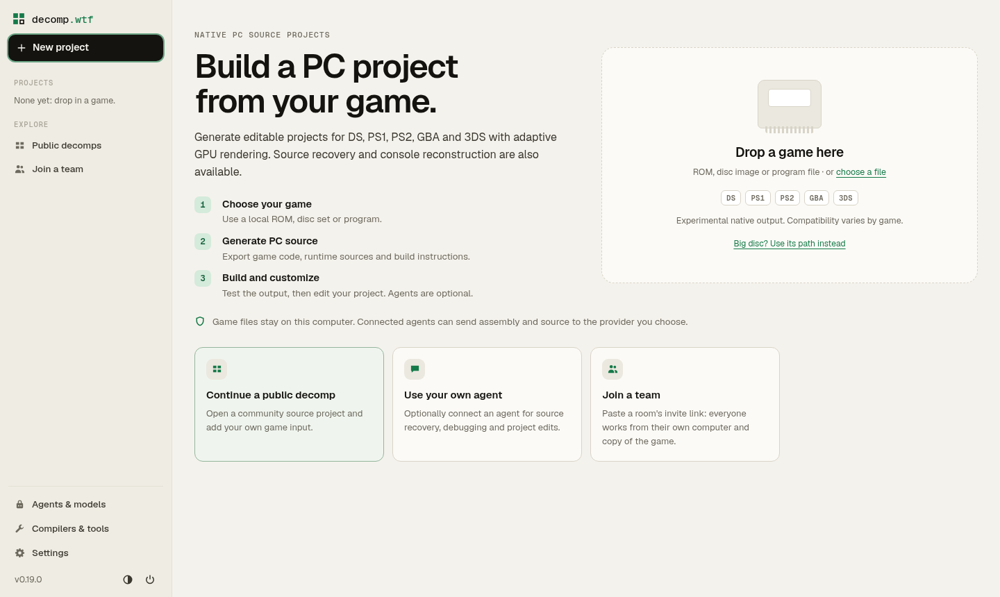

# decomp.wtf

Generate editable native PC source projects from supported **DS, PS1, PS2, GBA
and 3DS** games. Run the workbench locally, export game code and a source runtime,
then build and customize the result. Agents are optional.

[Get started](#get-started) · [Consoles](#supported-consoles) ·
[Downloads](#manual-downloads) · [Validation](#guides-and-validation) ·
[Roadmap](docs/future-work.md) · [Report an issue](https://github.com/OMGitsMatt45/decomp.wtf/issues)

<picture>
  <source media="(prefers-color-scheme: dark)" srcset=".github/assets/gui-dark.png">
  
</picture>

The screenshot shows a clean local workspace. No game media or generated retail
source is included in this repository. Compatibility is experimental and is
validated per game; a successful export alone does not certify a full playthrough.

## Get started

Install [uv](https://docs.astral.sh/uv/getting-started/installation/) and
[Git](https://git-scm.com/downloads), then run from the repository directory:

```sh
git clone https://github.com/OMGitsMatt45/decomp.wtf.git
cd decomp.wtf
uv sync --locked --group dev --python 3.12
uv run --locked decomp
```

You can also [download main as a ZIP](https://github.com/OMGitsMatt45/decomp.wtf/archive/refs/heads/main.zip).
Extract it and open a terminal in the folder containing `pyproject.toml` before
running the last two commands. uv installs the requested Python version and
locked application dependencies. The app opens in your browser and runs on your
computer. Use **New project** to select your game and native PC output.

On Windows, install uv with `winget install --id astral-sh.uv --exact`, then
reopen PowerShell. Native project builds also need the C++ tools below. See
[Windows setup](docs/windows.md) for native tool discovery and optional agents.

## Supported consoles

| Console | Inputs and output | Graphics | Guide |
| --- | --- | --- | --- |
| Nintendo DS | ARM9/ARM7 and overlays from `.nds`; both original screens | Adaptive OpenGL | [DS native output](docs/nds-native-runtime.md) |
| PlayStation | EXE or ordered disc/CUE/M3U inputs; one source project and executable for the disc set, with shared memory cards | Adaptive OpenGL | [PS1 native output](docs/ps1-native.md) |
| PlayStation 2 | ISO/BIN or EE ELF; automatic closed-code recovery and reviewed profiles for ambiguous layouts | Adaptive Vulkan | [PS2 native output](docs/future/ps2.md) |
| Game Boy Advance | `.gba`; ARM/Thumb, guarded RAM copies, cartridge saves and RTC | Adaptive OpenGL | [GBA native output](docs/future/gba.md) |
| Nintendo 3DS | Decrypted NCCH/CXI or NCSD/CCI images; ARM/Thumb/VFP, CRO/CRS modules and both original screens | Adaptive Vulkan | [3DS native output](docs/3ds-native.md) |

Outputs contain generated C/C++ game code, runtime sources, pinned dependencies,
asset preparation, CMake build targets and their own build/run instructions.
Windows and Linux host builds are qualified. Normal execution reports uncovered
or changed code instead of automatically falling back to an interpreter;
diagnostic/reference modes are identified separately.

The renderers adapt to the user's changing window and monitor resolution.
DS and 3DS retain their original two screens. Screen merging, mobile assets and
other game-specific enhancements belong in the exported project. PS1's ordered
disc set shares one executable; the guide documents disc changes and saves.

Console reconstruction and readable-source recovery remain separate workflows.
A console matching percentage is not a PC-port readiness measure. The
[PC-project contract](docs/pc-output.md) describes source integrity, execution
reports and the boundary between the shared backend and game-specific work.

### Export from the command line

Choose a new output directory for each export:

```sh
uv run --locked decomp pc status
uv run --locked decomp pc nds-native game.nds nds-source --experimental
uv run --locked decomp pc psx-native game.m3u ps1-source --experimental
uv run --locked decomp pc ps2-native game.iso ps2-source --experimental
uv run --locked decomp pc gba-native game.gba gba-source --experimental
uv run --locked decomp pc ctr-native game.3ds 3ds-source --experimental
uv run --locked decomp pc verify ps2-source
```

Follow the generated README to prepare your own assets, build and run the game.
`pc verify` checks project integrity. Per-game profiles, coverage reports and
execution validation are documented in the console guides.

## Manual downloads

Install the tools needed for the output you choose. Pinned translators, runtime
sources and supported CMake dependencies download automatically; original-console
matching compilers are not prerequisites for native PC export.

| Download | When you need it |
| --- | --- |
| [uv](https://docs.astral.sh/uv/getting-started/installation/) | Repository commands and locked Python environments. |
| [Git for Windows](https://git-scm.com/downloads/win) / [Git for Linux](https://git-scm.com/downloads/linux) | Clone this repository or community source projects. A source ZIP also works for local setup. |
| [Python 3.12+](https://www.python.org/downloads/) | uv can manage the application's Python automatically. Exported asset helpers use Python; follow their README. |
| [Visual Studio C++ Build Tools](https://visualstudio.microsoft.com/downloads/) | Windows builds: Visual Studio 2022 or later with **Desktop development with C++** and **C++ CMake tools for Windows**. The GPU wrappers find bundled CMake. |
| [CMake 3.24+](https://cmake.org/download/) | Build generated projects and translators. A suitable Visual Studio CMake component also works. |
| [GCC/C++](https://gcc.gnu.org/install/binaries.html) / [Clang](https://releases.llvm.org/download.html) | Linux host builds; install through your distribution's package manager. |
| [Rust 1.95+](https://www.rust-lang.org/tools/install) | Build the 3DS translator/runtime. Use the MSVC toolchain on Windows; pinned sources and locked crates download automatically. |
| Graphics drivers: [NVIDIA](https://www.nvidia.com/Download/index.aspx), [AMD](https://www.amd.com/en/support), [Intel](https://www.intel.com/content/www/us/en/download-center/home.html) | OpenGL for DS/PS1/GBA; Vulkan for PS2/3DS. Use your GPU vendor's driver or your distribution's Mesa packages. |
| Linux development packages: [pkg-config](https://packages.ubuntu.com/noble/pkg-config), [X11](https://packages.ubuntu.com/noble/libx11-dev), [Xext](https://packages.ubuntu.com/noble/libxext-dev), [OpenGL](https://packages.ubuntu.com/noble/libgl-dev), [EGL](https://packages.ubuntu.com/noble/libegl-dev), [ALSA](https://packages.ubuntu.com/noble/libasound2-dev), [libudev](https://packages.ubuntu.com/noble/libudev-dev), [FFmpeg](https://ffmpeg.org/download.html) | Desktop graphics, audio, controllers and PS2 movies. Each generated README lists its complete package-manager command; see also [SDL3's dependency guide](https://wiki.libsdl.org/SDL3/README-linux#build-dependencies). |

Use your own game inputs. Encrypted DS imports can need an owner-supplied ARM7
BIOS during decoding; GBA can translate an optional owner BIOS into the private
output. PS1 uses bundled MIT OpenBIOS; PS2 needs no retail BIOS. DS mobile OBB
files and 3DS boot ROMs are not standard runtime prerequisites.

<details>
<summary>Optional source-recovery, agent and reference tools</summary>

| Download | Optional use |
| --- | --- |
| [Java 21+ JDK (Eclipse Temurin)](https://adoptium.net/temurin/releases/?version=21) | Ghidra decompilation; put `java` on PATH. |
| [Node.js LTS](https://nodejs.org/en/download) | Agents installed through npm, including the app's Codex and opencode setup commands. |
| [Ollama](https://ollama.com/download) / [LM Studio](https://lmstudio.ai/download) | A local model provider, if you choose one. |
| [mGBA](https://mgba.io/downloads.html) | Independent GBA execution and raw-save comparisons. |
| [MAME / chdman](https://www.mamedev.org/release.html) | Unsupported CHD conversion or developer fixture regeneration. Supported imports need no external CHD tool. |
| [melonDS libretro core](https://github.com/libretro/melonDS) / [RetroArch](https://www.retroarch.com/?page=platforms) | Developer DS execution comparisons; see [DS qualification](docs/future/nds.md#execution-validation). Provide your own BIOS and firmware. |
| [GNU Make](https://www.gnu.org/software/make/) / [MSYS2](https://www.msys2.org/) | Build the optional DS reference core from source. A downloaded core does not need these tools. |
| [curl](https://curl.se/download.html) / [Ubuntu 32-bit runtime](https://packages.ubuntu.com/noble/libc6-i386) | Linux installer or legacy 32-bit matching compilers. |
| [DQ IV mobile](https://www.jp.square-enix.com/dqsp/dq4/en/), [DQ V mobile](https://www.jp.square-enix.com/dqsp/dq5/en/), [DQ VI mobile](https://www.jp.square-enix.com/dqsp/dq6/en/) | Future game-specific asset integrations. Generic DS output uses the DS input; mobile mappings are not implemented. |

**Compilers & tools** manages supported matching compilers and optional tools.
Proprietary DS compiler downloads require license acceptance. Community source
projects can have additional build requirements; follow their own instructions.

</details>

## Guides and validation

- [PC output contract](docs/pc-output.md), [current roadmap](docs/future-work.md)
  and [pull request index](docs/pr-scope-audit.md).
- [Windows GPU commands](docs/hardware-validation.md): original PS2, GBA and 3DS
  fixtures, Visual Studio CMake discovery, reports and troubleshooting.
- Owner-provided Intel Iris Xe results: [PS2](docs/ps2-hardware-validation.json),
  [GBA](docs/gba-hardware-validation.json), [3DS](docs/3ds-hardware-validation.json).
- Native execution evidence: [PS1](docs/ps1-native-validation.json),
  [GBA/Emerald](docs/gba-static-validation.json),
  [PS2](docs/ps2-native-validation.json)
  and the [initial five-console operational run](docs/operational-2026-10-26.md).
  Records identify tested revisions and bounded scope; full playthrough acceptance
  remains with the user.

For a focused shared-contract check:

```sh
uv run --locked --group dev python -m pytest -q tests/test_platform_scope.py tests/test_pc_output.py
```

The repository's [Actions workflows](https://github.com/OMGitsMatt45/decomp.wtf/actions)
qualify each backend on Windows and Linux using original fixtures. Retail media,
BIOS dumps and generated retail source stay outside Git. The older matching
application is preserved in [PR #27](https://github.com/OMGitsMatt45/decomp.wtf/pull/27);
paused game-specific source recovery is preserved in [PR #26](https://github.com/OMGitsMatt45/decomp.wtf/pull/26).

## License and credits

The application uses [MIT](LICENSE), based on
[Sam Wolfs's archived upstream](https://github.com/i12bp8/decomp.wtf).
Generated outputs retain their runtime/dependency terms, including **PolyForm
Noncommercial for the PS1 runtime** and **GPL-3.0 for PS2 runtime sources**.
This fork is not affiliated with Nintendo, Sony or the original maintainer.
